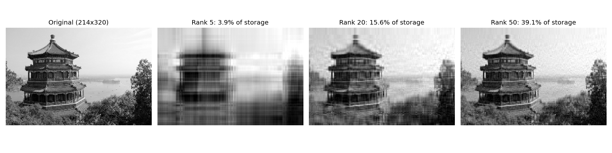

# Linear Algebra Toolkit

Core linear algebra routines implemented from scratch in Python with NumPy. NumPy is used only for array storage and basic arithmetic; the decompositions and solvers are written by hand and tested against `numpy.linalg`.

## What's included

| Module | Functions | Method |
|---|---|---|
| `linalg/lu.py` | `lu_decompose`, `lu_solve`, `determinant` | Gaussian elimination with partial pivoting (`PA = LU`) |
| `linalg/qr.py` | `qr_decompose`, `least_squares` | Householder reflections |
| `linalg/eigen.py` | `power_iteration`, `eigh_qr` | Power method; QR algorithm with Wilkinson shifts and deflation (symmetric matrices) |
| `linalg/svd.py` | `svd`, `low_rank` | One-sided Jacobi rotations; Eckart-Young low-rank approximation |

## Quick start

```bash
pip install -r requirements.txt
pytest                                    # 13 tests compare every routine against numpy.linalg
python examples/image_compression.py      # writes examples/svd_compression.png
```

```python
import numpy as np
from linalg import lu_solve, eigh_qr, svd

A = np.array([[4., 1.], [1., 3.]])
print(lu_solve(A, [1., 2.]))     # solve A x = b
vals, vecs = eigh_qr(A)          # eigenvalues (descending) and eigenvectors
U, s, Vt = svd(A)                # thin SVD
```

## Application: image compression with SVD

`examples/image_compression.py` loads a real photo (scikit-learn's bundled sample image, or your own with `--image`), converts it to grayscale, computes its SVD with this toolkit, and rebuilds it from the top k singular values. A rank-k approximation stores `k(m + n + 1)` numbers instead of `m * n`, and the script prints the storage ratio and relative error for each rank.

<!-- After running the example, commit the output and uncomment: -->
<!--  -->

## Notes on the math

- **LU:** the pivot row with the largest absolute entry is swapped in at each step for numerical stability. The determinant is the product of U's diagonal times the sign of the permutation.
- **QR:** each Householder reflector `H = I - 2vvᵀ` zeroes one column below the diagonal. The sign of `v` is chosen to avoid cancellation.
- **QR algorithm:** repeatedly factor `T - μI = QR` and form `RQ + μI`. Wilkinson shifts give fast convergence and deflation splits off each eigenvalue as it converges.
- **SVD:** Jacobi rotations orthogonalize the columns of A. The column norms are the singular values. This is more accurate than forming `AᵀA`, at the cost of speed.

## Limitations

The routines are written for clarity, not speed, and are much slower than LAPACK. `eigh_qr` handles symmetric matrices only, and `lu_solve` raises an error on singular matrices.

## License

MIT
